<h1 align="center">Retail EKS Platform</h1>

<p align="center">
  
</p>

<p>
  
  
  
  
  
  
  
  
  
  
</p>

Production-style AWS platform for a five-service retail store on Amazon EKS. Infrastructure is Terraform. Images are built by GitHub Actions and pushed to ECR over OIDC. The UI is synced by Argo CD. Catalog, carts, checkout, and orders are installed with Helm against managed AWS data stores.

This repository is the write-up and the screenshots from the validated run. Terraform, Helm, CI, and application source stay in a private repository.

> Built and validated, then torn down for cost control. The screenshots below were taken while the platform was running. Those hostnames do not resolve now.

| | |
| --- | --- |
| **Cluster** | `retail-dev-store` |
| **Region** | `us-east-1` |
| **Store** | [https://retail.simsoliver.com](https://retail.simsoliver.com) |
| **Grafana** | [https://grafana.simsoliver.com](https://grafana.simsoliver.com) |
| **Argo CD** | [https://argocd.simsoliver.com](https://argocd.simsoliver.com) |

## Contents

- [Architecture](#architecture)
- [What this demonstrates](#what-this-demonstrates)
- [Platform stacks](#platform-stacks)
- [Application](#application)
- [Continuous integration](#continuous-integration)
- [Amazon ECR](#amazon-ecr)
- [Continuous delivery](#continuous-delivery)
- [Compute](#compute)
- [Observability](#observability)
- [Repository layout](#repository-layout)
- [Operate](#operate)
- [Security](#security)

---

## Architecture

### Platform

<p align="center">
  
</p>

### Service architecture

<p align="center">
  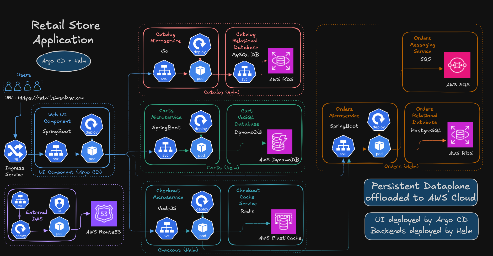
</p>

**Request path**

```text
User  →  Store ALB (group app)  →  UI
                                      ├─ catalog  →  RDS MySQL
                                      ├─ carts    →  DynamoDB Items (us-west-2)
                                      ├─ checkout →  ElastiCache Redis
                                      │                 └─ orders  →  RDS PostgreSQL + SQS
                                      └─ orders
```

UI is the only public app. The four backends are ClusterIP. Checkout is the only backend that calls another backend, and only when the shopper confirms.

---

## What this demonstrates

- Multi-stack Terraform with a shared encrypted S3 backend
- EKS with a managed node group plus Karpenter on-demand and spot NodePools
- Two internet ALBs: store (`app`) and operations (`ops`)
- ACM `*.simsoliver.com` and hostname-based Ingress
- Hybrid delivery: Argo CD for UI, Helm OCI for the four backends
- GitHub Actions OIDC to ECR (no long-lived AWS keys)
- RDS MySQL, RDS PostgreSQL, ElastiCache Redis, DynamoDB, SQS
- Secrets Manager + Secrets Store CSI for database credentials
- Prometheus / Grafana, Fluent Bit → CloudWatch, ADOT → X-Ray, Alertmanager → Slack

---

## Platform stacks

Apply order: **vpc → acm → eks → karpenter → nodepool → cert_manager → otel → metrics → monitoring → logging → db_secret → data → github_actions_ecr → argocd**.

| Stack | Role |
| --- | --- |
| s3 | Remote state bucket |
| vpc | `10.0.0.0/16`, 3 AZs, public + private, NAT, S3 endpoint |
| acm | Public certificate for `*.simsoliver.com` |
| eks | Cluster, managed node group, LBC, EBS CSI, ExternalDNS, Pod Identity, Secrets Store CSI |
| karpenter | Node autoscaler controller |
| nodepool | On-demand and spot NodePools |
| cert_manager | Webhook certificates for the OTEL operator |
| otel | ADOT collector and Instrumentation → X-Ray |
| metrics | Metrics Server for `kubectl top` and HPA |
| monitoring | kube-prometheus-stack, Grafana, Slack alerts |
| logging | Fluent Bit and per-service CloudWatch log groups |
| db_secret | Shared Secrets Manager password |
| data | MySQL, Postgres, Redis, DynamoDB, SQS, Pod Identity |
| github_actions_ecr | Five ECR repos + GitHub OIDC role |
| argocd | Argo CD and `argocd.simsoliver.com` |

---

## Application

Five services run in namespace `retail-store`.

| Service | Runtime | Deployed by | Data |
| --- | --- | --- | --- |
| ui | Java / Spring | Argo CD | none |
| catalog | Go | Helm | RDS MySQL `catalogdb` |
| carts | Java / Spring | Helm | DynamoDB `Items` in **us-west-2** |
| checkout | Node.js | Helm | ElastiCache Redis (draft only) |
| orders | Java / Spring | Helm | RDS PostgreSQL `ordersdb` + SQS |

### Purchase path

1. Browse catalog → MySQL read
2. Add to cart → DynamoDB write
3. Start checkout → Redis `SET` (session draft)
4. Address and delivery → Redis `SET` again on the same key
5. Confirm → Redis `GET`, call orders, Redis `DEL`
6. Orders `INSERT` Postgres and publish SQS
7. UI shows the new `orderId`

Redis holds the in-progress checkout. Postgres holds the finished sale.

<table width="100%">
  <tr>
    <th colspan="3" align="center">Home</th>
  </tr>
  <tr>
    <td colspan="3" align="center">
      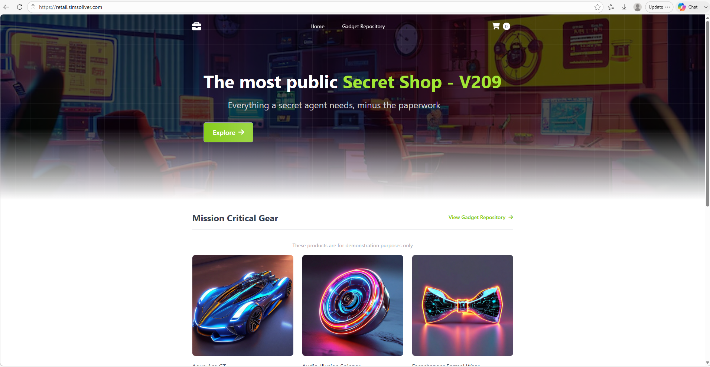
    </td>
  </tr>
  <tr>
    <th align="center" width="33%">Catalog</th>
    <th align="center" width="33%">Checkout</th>
    <th align="center" width="33%">Confirmation</th>
  </tr>
  <tr>
    <td align="center">
      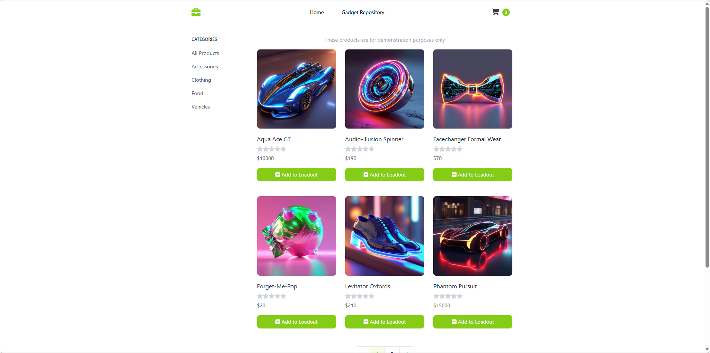
    </td>
    <td align="center">
      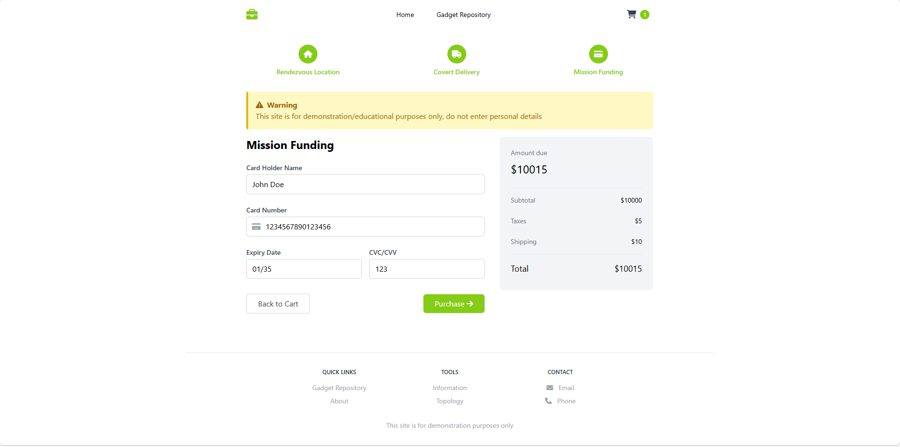
    </td>
    <td align="center">
      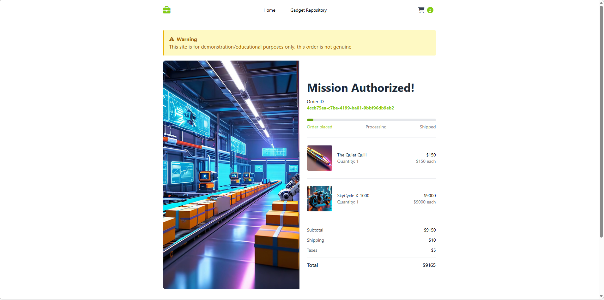
    </td>
  </tr>
</table>

---

## Continuous integration

A push to `main` in the private application repository runs the image pipeline.

1. Detect which of ui, catalog, cart, checkout, or orders changed
2. Assume the GitHub Actions IAM role through GitHub OIDC
3. Build and push `retail-store/<service>:sha-<7>` to Amazon ECR
4. Commit the new tag into the service values file

Trust is limited to that repository. There is no stored AWS access key.

<table width="100%">
  <tr>
    <th colspan="2" align="center">Login</th>
  </tr>
  <tr>
    <td colspan="2" align="center">
      
    </td>
  </tr>
  <tr>
    <th align="center" width="50%">Running</th>
    <th align="center" width="50%">Success</th>
  </tr>
  <tr>
    <td align="center">
      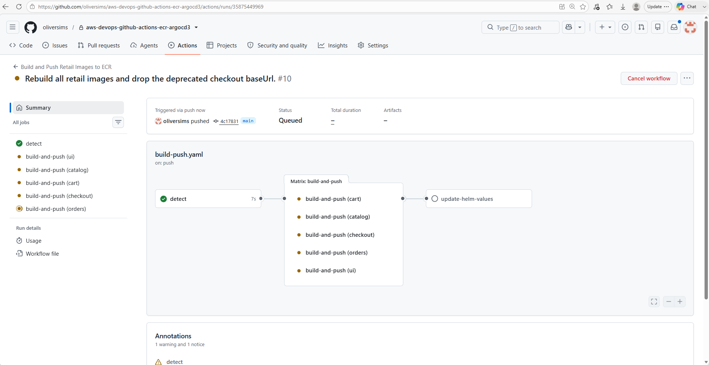
    </td>
    <td align="center">
      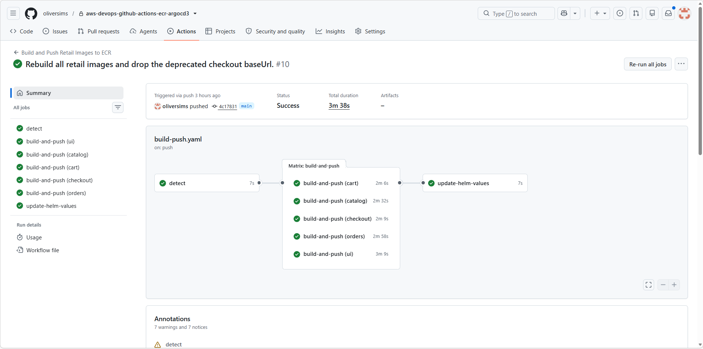
    </td>
  </tr>
</table>

---

## Amazon ECR

Five private repositories hold the retail images. Tags are immutable (`sha-<7>`). Cluster nodes pull from these repositories after CI pushes.

<table width="100%">
  <tr>
    <th colspan="6" align="center">Repositories</th>
  </tr>
  <tr>
    <td colspan="6" align="center">
      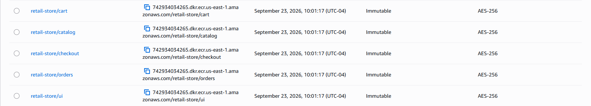
    </td>
  </tr>
  <tr>
    <th colspan="2" align="center" width="33%">ui</th>
    <th colspan="2" align="center" width="33%">catalog</th>
    <th colspan="2" align="center" width="33%">cart</th>
  </tr>
  <tr>
    <td colspan="2" align="center">
      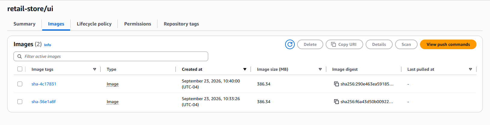
    </td>
    <td colspan="2" align="center">
      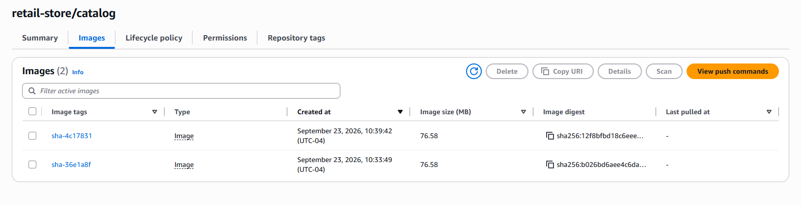
    </td>
    <td colspan="2" align="center">
      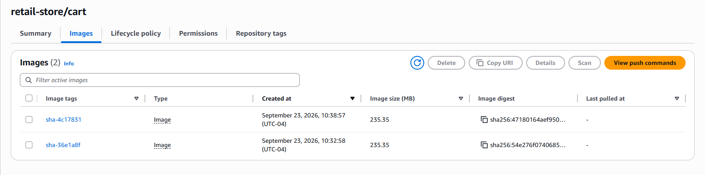
    </td>
  </tr>
  <tr>
    <th colspan="3" align="center" width="50%">checkout</th>
    <th colspan="3" align="center" width="50%">orders</th>
  </tr>
  <tr>
    <td colspan="3" align="center">
      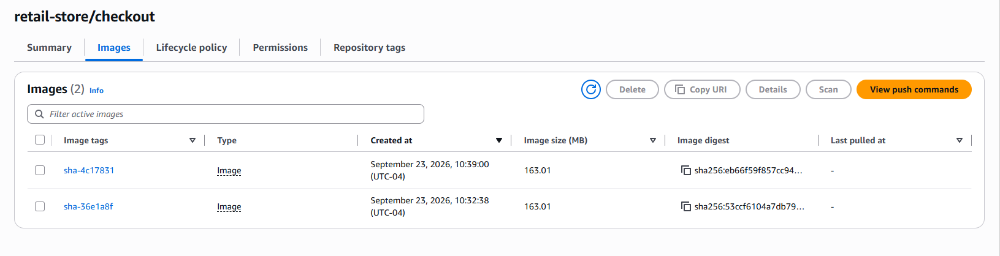
    </td>
    <td colspan="3" align="center">
      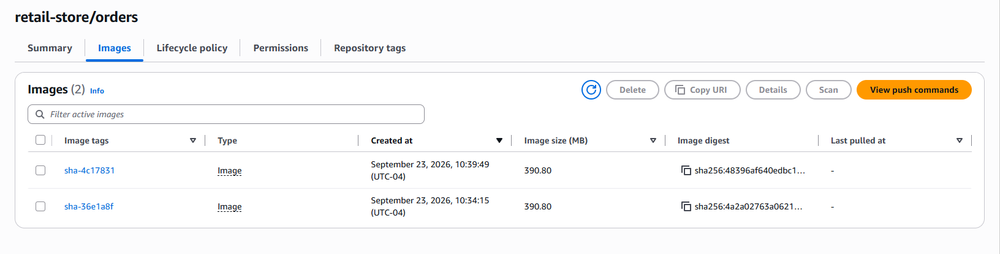
    </td>
  </tr>
</table>

---

## Continuous delivery

**Argo CD** watches the UI chart and syncs Application `ui` into `retail-store`. Automated sync, prune, and self-heal are enabled.

**Helm** installs catalog, carts, checkout, and orders from OCI charts with two values files: AWS data-plane settings, then the CI image tag.

<table width="100%">
  <tr>
    <th align="center" width="50%">UI Healthy and Synced</th>
    <th align="center" width="50%">Login</th>
  </tr>
  <tr>
    <td align="center">
      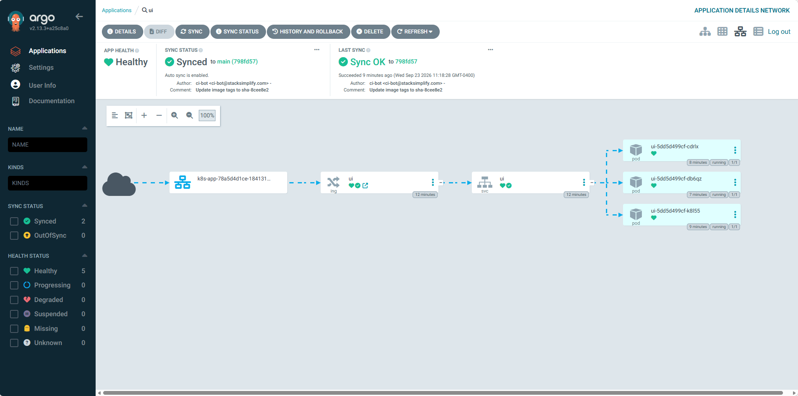
    </td>
    <td align="center">
      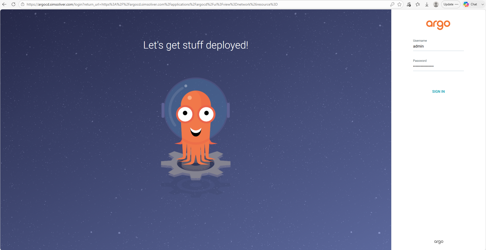
    </td>
  </tr>
</table>

---

## Compute

Managed node group `retail-dev-private-ng` holds system add-ons. Karpenter adds on-demand and spot nodes when retail pods do not fit. Node disks are encrypted gp3. EBS CSI is used for the Prometheus 50Gi volume only.

<table width="100%">
  <tr>
    <th colspan="3" align="center" width="50%">EKS nodes</th>
    <th colspan="3" align="center" width="50%">EC2 workers</th>
  </tr>
  <tr>
    <td colspan="3" align="center">
      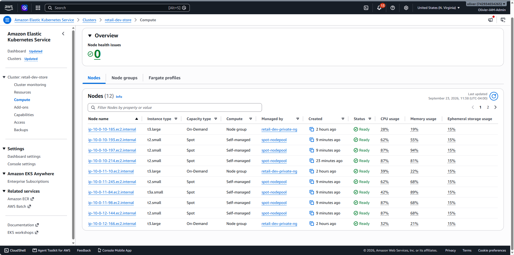
    </td>
    <td colspan="3" align="center">
      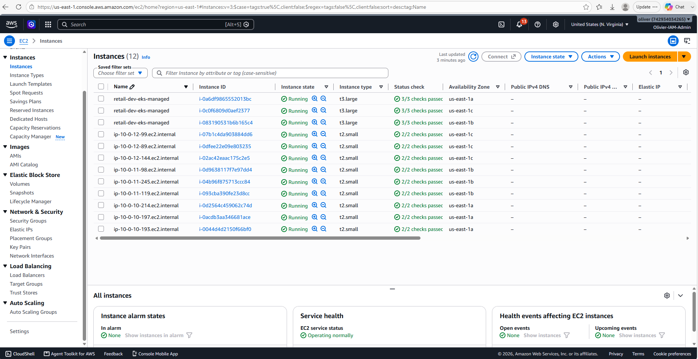
    </td>
  </tr>
  <tr>
    <th colspan="2" align="center" width="33%">System pods</th>
    <th colspan="2" align="center" width="33%">Argo CD and cert-manager</th>
    <th colspan="2" align="center" width="33%">ui and catalog</th>
  </tr>
  <tr>
    <td colspan="2" align="center">
      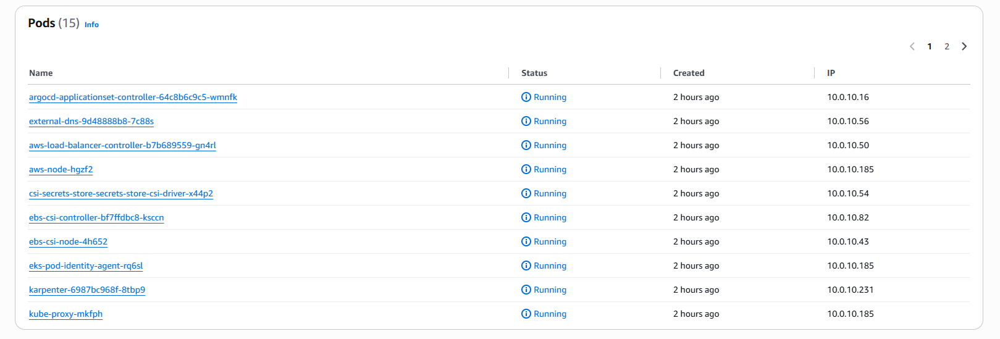
    </td>
    <td colspan="2" align="center">
      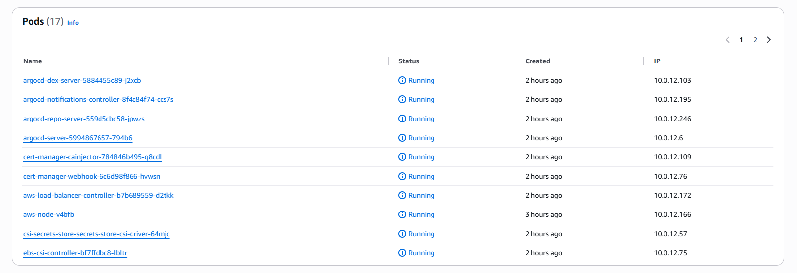
    </td>
    <td colspan="2" align="center">
      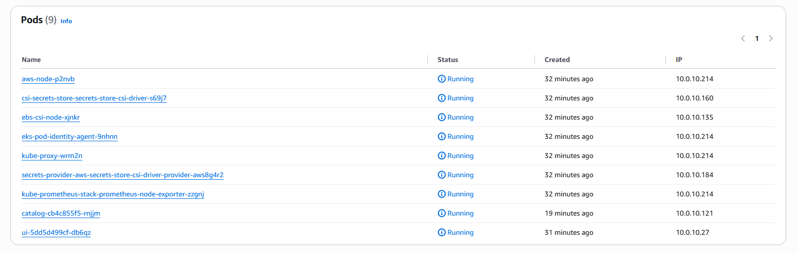
    </td>
  </tr>
  <tr>
    <th colspan="3" align="center" width="50%">carts</th>
    <th colspan="3" align="center" width="50%">checkout</th>
  </tr>
  <tr>
    <td colspan="3" align="center">
      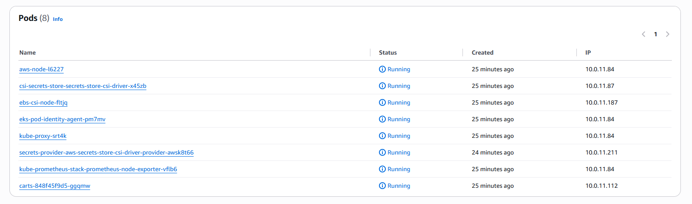
    </td>
    <td colspan="3" align="center">
      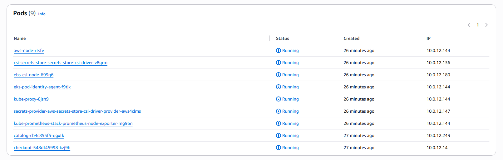
    </td>
  </tr>
</table>

---

## Observability

| Signal | Tool | Destination |
| --- | --- | --- |
| **Metrics** | Prometheus + Grafana | Grafana at `grafana.simsoliver.com` (ALB group `ops`). Prometheus keeps 15 days on a 50Gi gp2 PVC. Alertmanager stays in-cluster. |
| **Logs** | Fluent Bit | CloudWatch, 7-day retention: `/retail-dev-store/ui` · `/catalog` · `/carts` · `/checkout` · `/orders` |
| **Traces** | ADOT collector | X-Ray / Application Signals. Probe and health spans are dropped. SQL and store-service spans are kept. |
| **Alerts** | Alertmanager | Slack `#alert` |

### Metrics

<table width="100%">
  <tr>
    <th colspan="2" align="center">Login</th>
  </tr>
  <tr>
    <td colspan="2" align="center">
      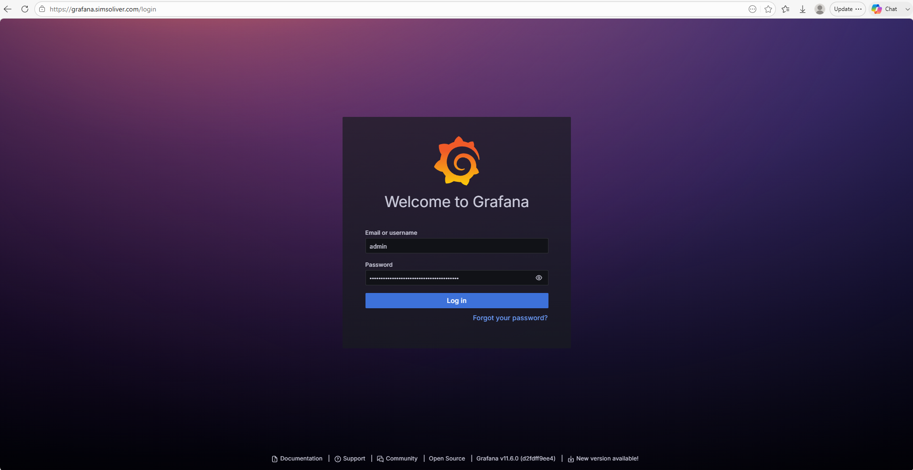
    </td>
  </tr>
  <tr>
    <th align="center" width="50%">carts CPU</th>
    <th align="center" width="50%">checkout network</th>
  </tr>
  <tr>
    <td align="center">
      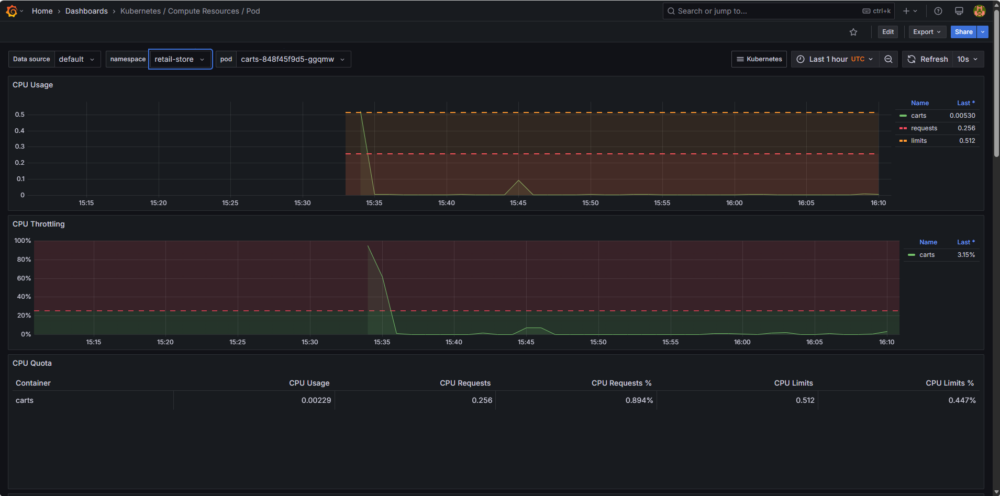
    </td>
    <td align="center">
      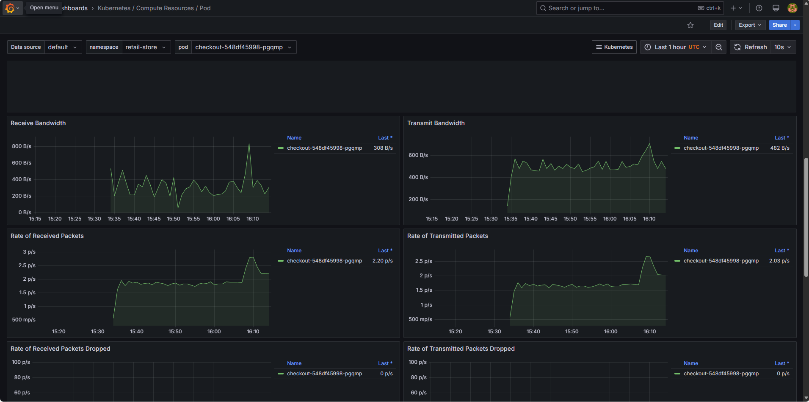
    </td>
  </tr>
</table>

### Logs

<table width="100%">
  <tr>
    <th colspan="6" align="center">Log groups</th>
  </tr>
  <tr>
    <td colspan="6" align="center">
      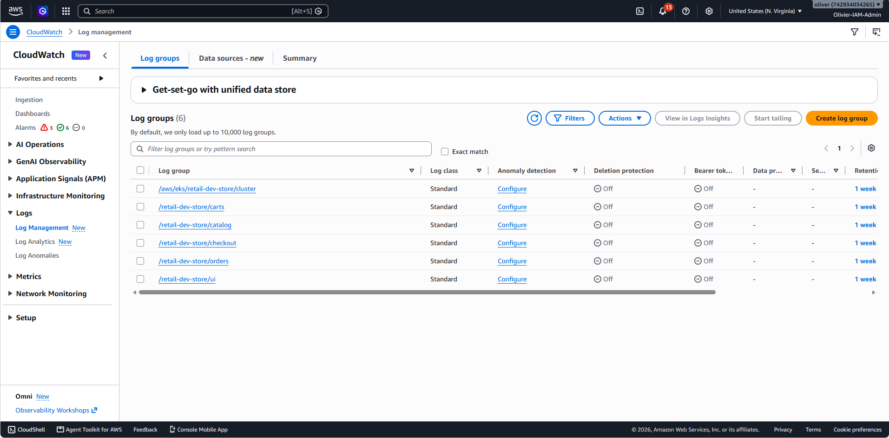
    </td>
  </tr>
  <tr>
    <th colspan="2" align="center" width="33%"><code>ui</code></th>
    <th colspan="2" align="center" width="33%"><code>catalog</code></th>
    <th colspan="2" align="center" width="33%"><code>carts</code></th>
  </tr>
  <tr>
    <td colspan="2" align="center">
      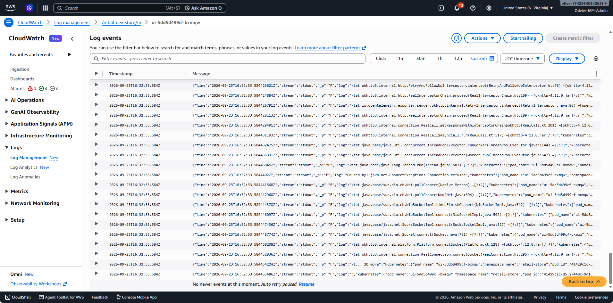
    </td>
    <td colspan="2" align="center">
      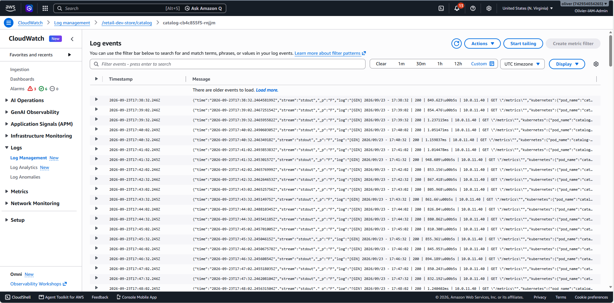
    </td>
    <td colspan="2" align="center">
      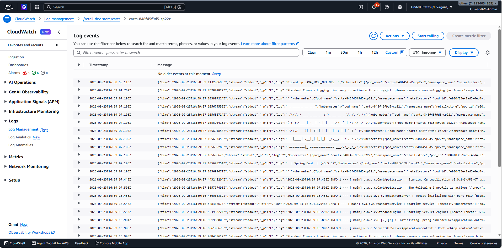
    </td>
  </tr>
  <tr>
    <th colspan="3" align="center" width="50%"><code>checkout</code></th>
    <th colspan="3" align="center" width="50%"><code>orders</code></th>
  </tr>
  <tr>
    <td colspan="3" align="center">
      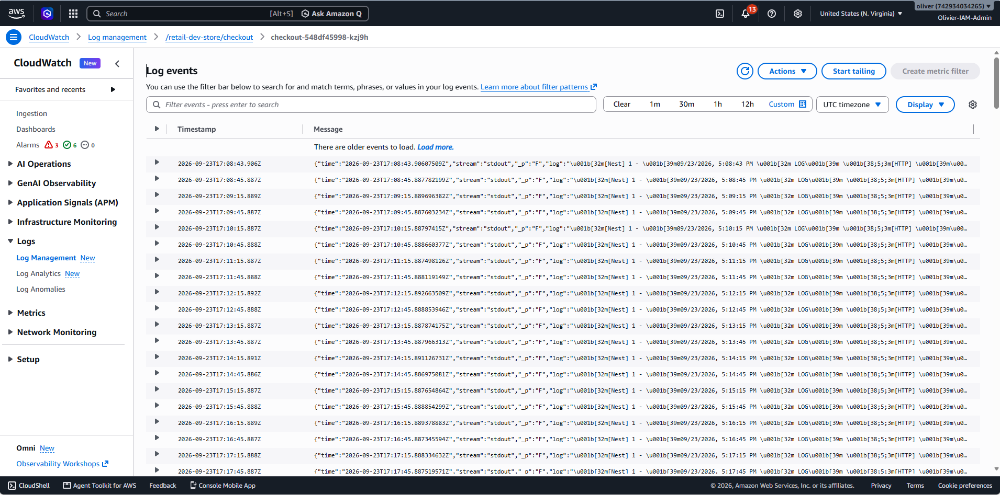
    </td>
    <td colspan="3" align="center">
      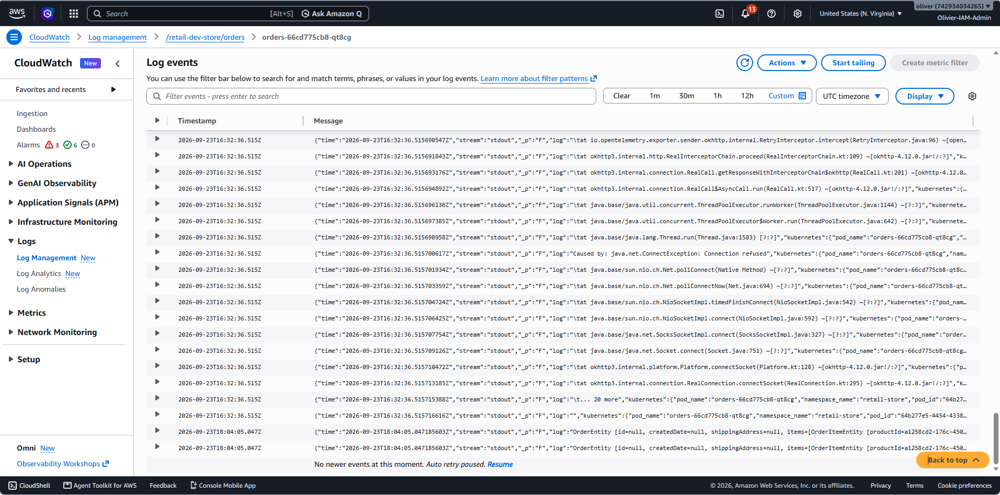
    </td>
  </tr>
</table>

### Traces

<table width="100%">
  <tr>
    <th colspan="2" align="center">Services</th>
  </tr>
  <tr>
    <td colspan="2" align="center">
      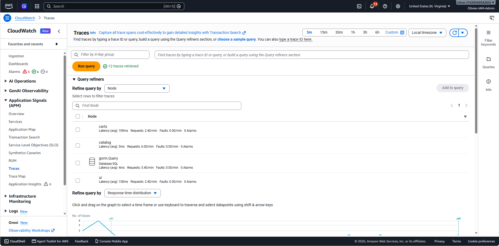
    </td>
  </tr>
  <tr>
    <th align="center" width="50%">Trace list</th>
    <th align="center" width="50%">Service map</th>
  </tr>
  <tr>
    <td align="center">
      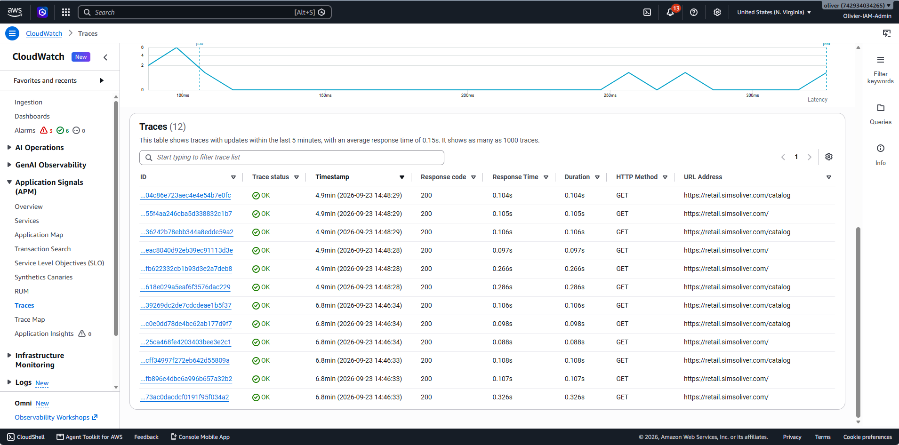
    </td>
    <td align="center">
      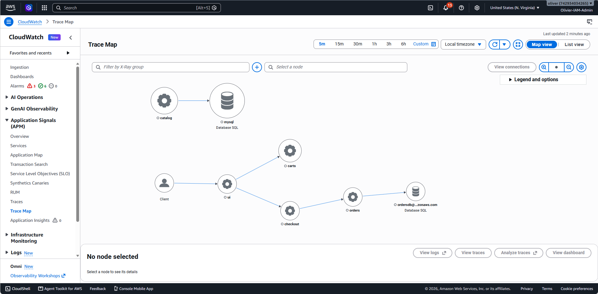
    </td>
  </tr>
</table>

### Alerts

<table width="100%">
  <tr>
    <th align="center" width="50%">Workspace</th>
    <th align="center" width="50%">Alerts</th>
  </tr>
  <tr>
    <td align="center">
      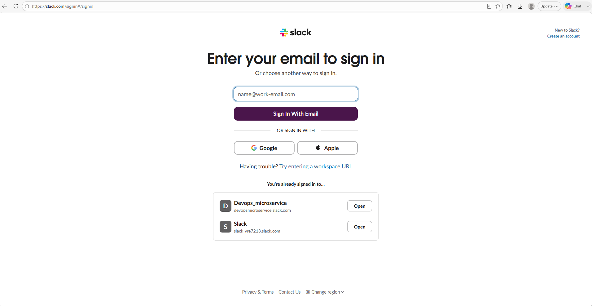
    </td>
    <td align="center">
      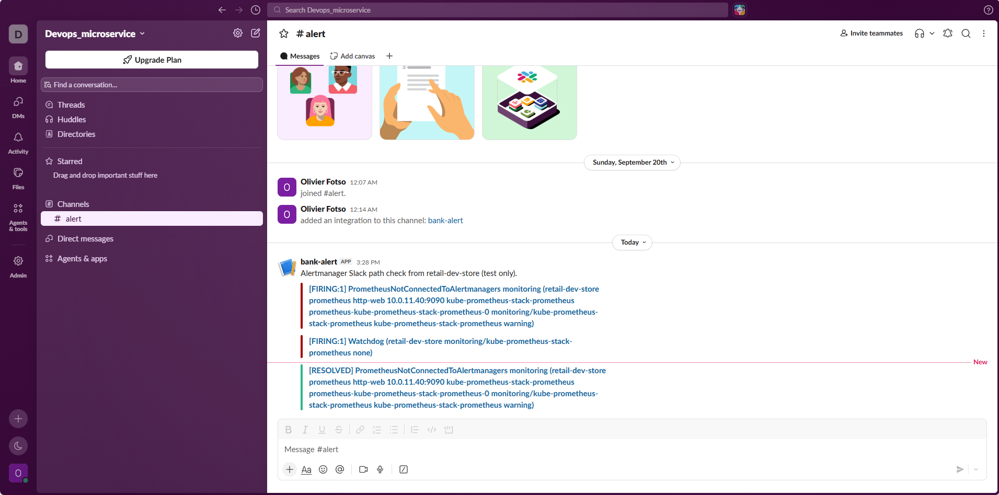
    </td>
  </tr>
</table>

---

## Repository layout

This public repository holds the report only:

```text
README.md           this write-up
images/             architecture diagrams and live console captures
LICENSE             all rights reserved
```

Private source layout (not in this repository):

```text
platform/           VPC through logging
retail-store/       data plane, Argo CD, ECR, Helm
retail-store/app/   five services and image CI
```

---

## Operate

Bring-up, from a private checkout:

1. Recreate the Terraform state bucket if it was destroyed
2. Apply platform stacks, VPC through logging
3. Apply the retail data plane
4. Apply CI/CD: ECR, GitHub OIDC, and Argo CD
5. Register the private GitHub repo and apply the UI Application
6. Helm-install catalog, carts, checkout, and orders

Tear down in reverse. Leftover VPC CNI ENIs and the EKS cluster security group are swept after the EKS stack and before VPC.

---

## Security

- Private worker subnets, one NAT, no public node IPs
- EKS Pod Identity instead of long-lived keys on pods
- GitHub OIDC instead of AWS keys in Actions
- Database password in Secrets Manager, mounted with Secrets Store CSI
- Slack webhook and leftover Helm values that held credentials stay out of Git
- Terraform state stays in S3 (or local during bootstrap), not in this repository

---

[oliversims](https://github.com/oliversims)
